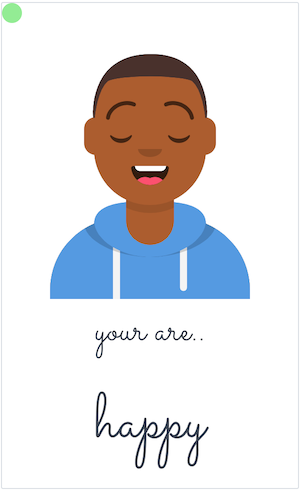
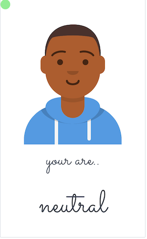

# Avatar Face Expression (v2)


Express your feelings through live SVG avatars in your browser using [face-api.js](https://github.com/justadudewhohacks/face-api.js) and [Avataaars](https://avataaars.com).

**100% local in your browser** — no video ever leaves your device.

## Features

- **7 Live Facial Expressions:** `Happy`, `Neutral`, `Surprised`, `Sad`, `Angry`, `Fearful`, `Disgusted` with real-time confidence bars & session mood mix
- **3 Avatar Packs:**
  - **Classic** (Avataaars Male/Female with `Auto / Male / Female` lock)
  - **Robo-Bot** (custom dynamic SVG robot)
  - **Mood Blob** (custom dynamic SVG blob)
- **Live Face Dynamics:** Head-tilt, left/right yaw, blinking (EAR), and mouth openness (MAR)
- **Customize Drawer:** Glasses / Shades overlay + Skin, Hair & Style color swatches (saved in `localStorage`)
- **2×2 Mood Photobooth:** 4-pose countdown (`3-2-1-SNAP!`) with instant 2×2 PNG collage export
- **Speed-Run Challenge:** 20-second emotion challenge with `localStorage` high score & Web Audio chime
- **PNG Snapshot & Webcam PiP:** Download your current avatar or toggle a mirrored webcam preview with landmark overlay
- **Light & Dark Mode:** Automatic system theme detection with manual toggle

## Run Locally

Webcam access (`getUserMedia`) requires `localhost` or `https`:

```bash
git clone https://github.com/SimHub/avatar-face-expression.git
cd avatar-face-expression
python3 -m http.server 8080
```

Open `http://localhost:8080` in your browser.

## Demo

<a href="https://codepen.io/simhub/pen/RwbXzrj?editors=1000"> CODEPEN</a>

<a href="https://simhub.github.io/avatar-face-expression/"> GITHUB.IO</a>




 
